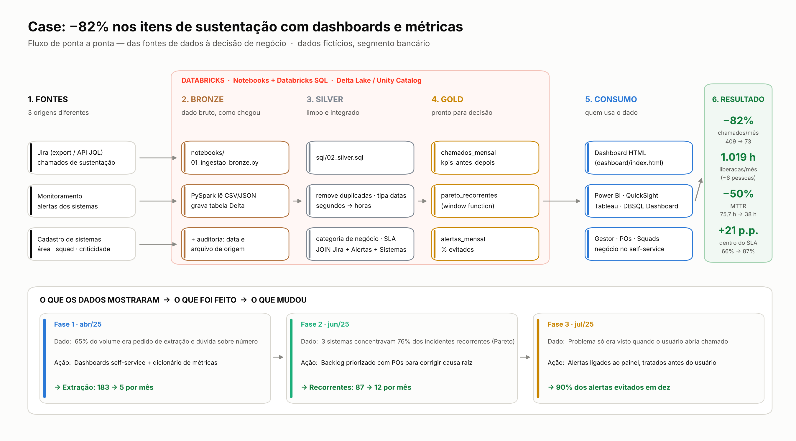
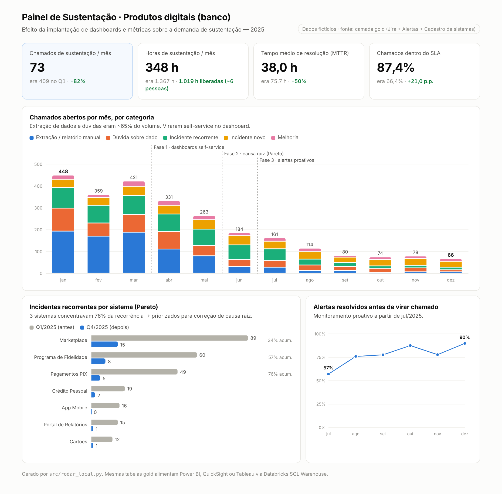
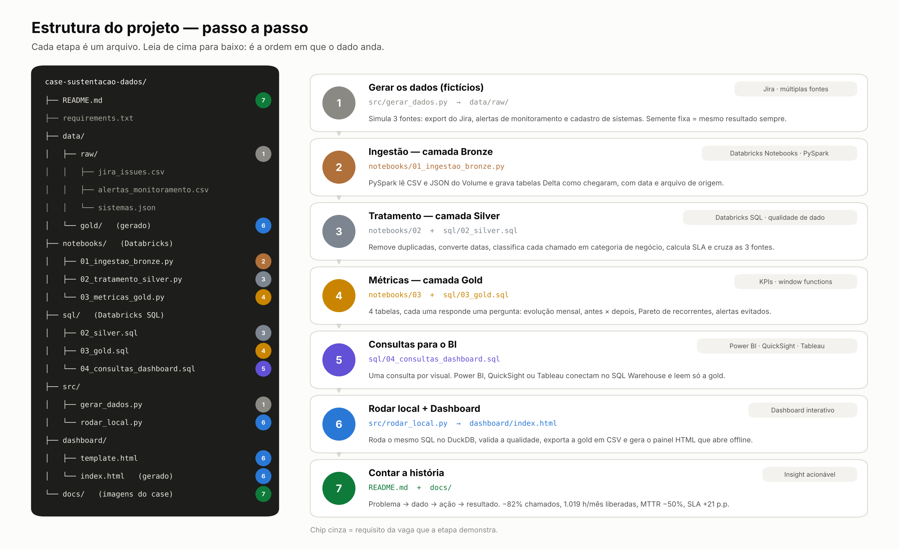

# Case: −82% nos itens de sustentação com dashboards e métricas

Case de portfólio baseado numa situação real que vivi: um time de sustentação de produtos digitais
afogado em chamados, sem saber **do que** esses chamados eram feitos.
Os dados aqui são **fictícios** (gerados por script), mas a lógica e o resultado são os do caso real.



## O problema
~410 chamados por mês. Ao classificar os dados do Jira, apareceu que **65% não eram defeito de sistema**:
eram pedidos de extração de dados e dúvidas sobre números. O resto se concentrava em poucos sistemas
com incidentes que se repetiam.

## O que foi feito
| Fase | O dado mostrou | Ação |
|---|---|---|
| 1 · abr/25 | Extração e dúvida = 65% do volume | Dashboards self-service + dicionário de métricas |
| 2 · jun/25 | 3 sistemas = 76% dos recorrentes (Pareto) | Backlog priorizado com os POs para corrigir a causa raiz |
| 3 · jul/25 | Problema só aparecia quando o usuário reclamava | Alertas de monitoramento ligados ao painel |

## Resultado (Q1 × Q4 de 2025)
- Chamados/mês: **409 → 73 (−82%)**
- Horas de sustentação: **1.367 → 348 por mês** (~6 pessoas liberadas para evolução)
- MTTR: **75,7 h → 38 h** · Dentro do SLA: **66% → 87%**



## Como rodar

**Local (1 minuto, sem Databricks):**
```bash
pip install -r requirements.txt
python src/gerar_dados.py     # cria data/raw/
python src/rodar_local.py     # bronze -> silver -> gold e gera dashboard/index.html
```
Abra `dashboard/index.html` no navegador.

**No Databricks (Free Edition serve):**
1. Clone o repositório como *Git folder* no workspace.
2. Suba os 3 arquivos de `data/raw/` para o Volume `/Volumes/sustentacao/raw/arquivos`.
3. Rode os notebooks `01` → `02` → `03` (ou agende como Job).
4. Use `sql/04_consultas_dashboard.sql` no Databricks SQL ou conecte Power BI / QuickSight / Tableau no SQL Warehouse.

## Estrutura


```
data/raw/        3 fontes: Jira, alertas, cadastro de sistemas
notebooks/       Databricks: bronze (PySpark), silver e gold
sql/             Databricks SQL: regra de negócio e consultas do dashboard
src/             gerador de dados e execução local (DuckDB)
dashboard/       painel HTML gerado a partir da gold
```

## Decisões
- **SQL em arquivo separado**: o mesmo SQL roda no Databricks e no DuckDB local. Uma regra, um lugar.
- **Medalhão (bronze/silver/gold)**: bronze guarda o dado como veio. Se a regra mudar, reprocesso sem pedir o export de novo.
- **Q1 × Q4**: comparo médias de trimestres, não um mês isolado, para não vender sazonalidade como resultado.
- **Checagens de qualidade** antes de publicar: dashboard com número errado é pior que dashboard nenhum.

## Próximos passos
- Ler o Jira direto pela API REST (JQL) em vez do export CSV
- Carga incremental (`MERGE INTO`) no lugar de `overwrite`
- Alerta automático quando a categoria "extração" voltar a subir

---
Anderson Joel Portes · [LinkedIn](https://linkedin.com/in/anderson-joel-portes)
